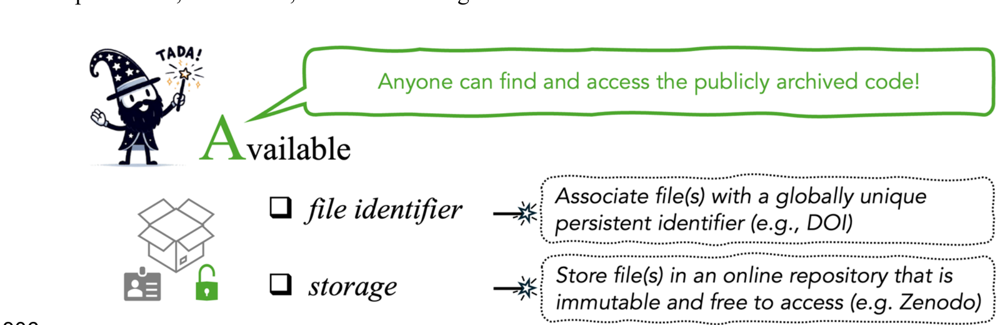

# [A]{.k-a1} — Available {#available}

::: {.tada-key}
**Availability** means **publicly archiving the code** so that anyone outside
the project has long-term access to it. It covers two FAIR principles:
**Findable**, through a unique identifier, and **Accessible**, because the code
can be retrieved via that identifier.
:::

::: {.tada-figure}
{alt="The TADA paper’s summary of advice on making analytical code Available."}

Figure 4 from [Ivimey-Cook et al.]{.tada-cite data-key="ivimey-cook-2025-tada"}

:::

There are two requirements:

1. The code has an associated **globally unique persistent identifier (PID)**,
   in practice a DOI.
2. That identifier is **cited in the corresponding manuscript**.

## Why GitHub is not an archive {#available-github}

GitHub is a good platform for *developing* code, with transparent version
control and easy collaboration. For archiving the code behind a published paper,
though, it fails on two counts:

- **It has no persistent identifier.** A GitHub URL is not a PID.
- **It is not immutable.** Files can be changed or deleted at any time,
  including after the manuscript is published. If the code behind a result is
  later edited or removed, that result can no longer be reproduced.

The same goes for similar platforms such as **Codeberg**, **Bitbucket** and
**GitLab**.

::: {.tada-tip}
You do not have to choose. **Develop on GitHub and archive on Zenodo.** Link
the repository to Zenodo and create a release on GitHub. Zenodo copies that
release and mints a DOI for it. See
<https://help.zenodo.org/docs/profile/linking-accounts/>.
:::

## Where to archive {#available-where}

You need a repository that is **immutable**, **free to access** and assigns a
DOI.

| Repository | PID | Immutable | Notes |
|---|---|---|---|
| **Zenodo** | DOI | [Yes]{.tada-yes} | Connects directly to a GitHub project. Gives a base project-level DOI (otherwise known as a concept DOI) as well as version-specific DOIs. You can choose the licence at deposit; CC BY 4.0 is the default. |
| **Figshare** | DOI | [Yes]{.tada-yes} | General-purpose, and widely used for code and supplementary material. Like Zenodo, connects to a GitHub project and gives a base project-level DOI as well as version-specific DOIs. Assigns CC0 to datasets by default. |
| **Dryad** | DOI | [Yes]{.tada-yes} | Data-focused, and **mandates CC0**, which is not well suited to code (see [licences](#documented-licence)). Code uploaded to Dryad as software is published on Zenodo instead ([Lowenberg 2021]{.tada-cite data-key="lowenberg-2021"}). May charge a deposit fee unless your institution or journal covers it. |
| **Dataverse** | DOI | [Yes]{.tada-yes} | General-purpose. Published versions are fixed: editing a published dataset creates a new draft version ([Dataverse Project n.d.]{.tada-cite data-key="dataverse-guide"}). |
| **Software Heritage** | SWHID | [Yes]{.tada-yes} | Preserves GitHub projects for long-term storage and provides PIDs as Software Hash Identifiers. |
| **OSF** | DOI | [No]{.tada-no} | Widely used, and supports anonymised links for double-blind review, but the SORTEE guidelines note that it **does not provide file immutability**, so projects and files can be changed or deleted ([Pick et al. 2026]{.tada-cite data-key="pick-2026"}). OSF *registrations* are the exception: they are fixed once submitted and cannot be edited. From 16 November 2026 new OSF projects cannot be created, and existing projects become read-only after 19 February 2027 ([COS](https://www.cos.io/hubfs/OSF%20Transition_Resources%20for%20Publishers%20v2.pdf)). Fine for review, but archive elsewhere. |
| Domain repositories (e.g. **GenBank**) | Accession no. | [Yes]{.tada-yes} | For sequences and other domain-specific deposits. Other PID types include ARK, Handle and RRID. |
| GitHub / GitLab / Bitbucket / Codeberg | **None** | [No]{.tada-no} | Development platforms. Use for writing code, not for archiving it. |

::: {.tada-warn}
**Supplementary material is not archiving.** The SORTEE guidelines say that
data should not be provided only as supplementary material attached to the
article online, because it has no globally unique persistent identifier and may
not be open and accessible ([Pick et al. 2026]{.tada-cite data-key="pick-2026"}). The same goes for code. Everything must go in a public repository.
:::

::: {.tada-wiki}
**DOI versioning.** On Zenodo, every new version of the code gets a new
[version-specific DOI](#gloss-version-doi), and a
[base project-level DOI](#gloss-project-doi) (otherwise known as a concept DOI
on Zenodo) stays the same and always resolves to the latest version. Cite the
**version-specific DOI** in your paper, because that is the version your
results came from. Give the base project-level DOI to someone who wants the
latest version. If the code changes
during peer review, archive the revised code as a new version and update the
DOI cited in the manuscript before publication.
:::

## Cite the code in the manuscript {#available-cite}

Archiving is only half of the requirement. The PID must also be cited in the
manuscript, in the text and in the reference list, so the code can be found like
any other cited work. The [SORTEE guidelines](#sortee) require this for both data (Guideline 1.1) and code (Guideline 3.1;
[Pick et al. 2026]{.tada-cite data-key="pick-2026"}).

::: {.tada-wiki}
A worked example, using the TADA paper's own example repository:

> **In the data availability statement.** All data and code needed to reproduce
> the analyses are archived on Zenodo:
> <https://doi.org/10.5281/zenodo.23648444>.
>
> **In the reference list.** Ivimey-Cook, E. R., & Pick, J. L. (2026).
> *Example repository for: 'TADA! Simple guidelines to improve analytical code
> sharing for transparency and reproducibility'* (Update_v2) [Computer
> software]. Zenodo. <https://doi.org/10.5281/zenodo.23648444>

Both cite the version-specific DOI. The project's
[base project-level DOI](#gloss-project-doi) (otherwise known as a concept DOI
on Zenodo) is <https://doi.org/10.5281/zenodo.20752886>. It always resolves to
the latest version, so give it to readers who want the most recent code.
:::

## Data and code in the same place {#available-together}

The SORTEE guidelines recommend archiving code files **preferably in the same
archived project as the data files** (Guideline 3.1), which minimises problems
with computational reproducibility ([Pick et al. 2026]{.tada-cite data-key="pick-2026"}). A reader gets one deposit,
one DOI and one download, and the relative paths in your code keep working.

Sometimes this is not possible: some repositories treat data and code
differently, and Dryad's CC0-only licensing is a real constraint for code. In
that case, archive them separately and link them in **both** READMEs. See
[Documented](#documented).

## Consequences of not archiving {#available-wrong}

In the "pre-TADA" version of our worked example in the TADA paper, the code is not
archived and has no DOI, so there is no permanent, immutable, citable copy of
it ([Ivimey-Cook et al. 2025]{.tada-cite data-key="ivimey-cook-2025-tada"}).
By contrast, the TADA paper's example repository is archived on Zenodo with its
own DOI; see the [worked example above](#available-cite).

::: {.tada-wiki}
Two things follow. A reader who finds the paper cannot reliably find the code,
and if the working copy is edited or lost, the analysis behind the published
result cannot be recovered.
:::

## Sensitive data and embargoes {#available-sensitive}

Some data cannot be shared openly, such as medical records, identifying
personal information, the locations of endangered species or fossil sites at
risk of vandalism, and data covered by Indigenous data sovereignty (see the
[CARE principles](#gloss-care);
[Carroll et al. 2020]{.tada-cite data-key="carroll-2020"};
[Carroll et al. 2021]{.tada-cite data-key="carroll-2021"}). The SORTEE guidelines allow for these cases, note that such
data can often be obfuscated or anonymised instead, and note that many
repositories offer **embargoes** ([Pick et al. 2026]{.tada-cite data-key="pick-2026"}).

::: {.tada-wiki}
The exception normally applies to the **data**, not the **code**. Code that
cannot run without restricted data is still worth archiving openly, because it
documents exactly what was done.
:::

Describe the restriction, and how to get legitimate access, in both the data
availability statement and the README.

## Anonymising for double-blind review {#available-anonymous}

If your journal operates double-blind review, reviewers still need to see the
code. There are two options:

- **Submit anonymised data and code directly to the journal**, for example as a
  zip file.
- **Upload to a repository that supports anonymised review links**, such as
  Zenodo, Figshare, the Open Science Framework (OSF) or Dryad. GitHub does
  not offer this on its own, because your username is part of every
  repository's address; use a separate anonymising service (below).

The README can also be anonymised during peer review to comply with
double-blind policies, then restored once the paper is accepted. See
[Documented](#documented-readme).

### How to do it on each platform {.unlisted .unnumbered}

::: {.tada-wiki}
How each service handles anonymous review, checked against its own help pages
in October 2026. Features change, so check the current help pages before you
rely on one.

| Where | How | Watch out for |
|---|---|---|
| **Zenodo** | Either list the authors as "Anonymous", publish the record openly, and add the real authors once the paper is accepted (one of two options the British Ecological Society [suggests](https://methodsblog.com/2023/08/23/double-anonymous-peer-review-frequently-asked-questions/)). You can [edit a published record's authors](https://help.zenodo.org/docs/deposit/manage-records/) at any time without changing its DOI. Or keep the record restricted (or as an unpublished draft) and send reviewers a [secret link](https://help.zenodo.org/docs/share/about), which works without a Zenodo account. | The BES notes that if reviewers have to *request* access to a restricted record, the request shows them your username. |
| **Dryad** | Tick ["Private for Peer Review"](https://blog.datadryad.org/2026/03/31/private-for-peer-review/). Reviewers get a temporary link to the dataset's title, files and README, designed for double-anonymous review. A DOI is [reserved at submission](https://blog.datadryad.org/2023/02/21/for-journals-benefits-of-our-private-for-peer-review-mode/) and goes live at publication. | The README is included, so anonymise it. The link stops working at publication and should not go in the data availability statement; use the DOI there. |
| **Figshare** | Create a [private link](https://info.figshare.com/?p=2628). It shows the item with author information removed, lets reviewers download the files, and can be set to expire. | Anyone with the link can see the item, even before it is published. |
| **OSF** | Create a view-only link with **Anonymize** ticked, which hides contributor names. Only admins can create one. Use a link on an embargoed [registration](https://help.osf.io/article/330-welcome-to-registrations) rather than a project. | From 16 November 2026, new OSF projects cannot be created, existing projects become read-only after 19 February 2027, and project links will stop working once COS removes private project storage ([COS](https://www.cos.io/hubfs/OSF%20Transition_Resources%20for%20Publishers%20v2.pdf)). Registration links are not affected. |
| **GitHub** | Use [Anonymous GitHub](https://anonymous.4open.science) ([project page](https://github.com/tdurieux/anonymous_github)). Give it your repository and a list of terms to hide, such as your name and institution. It hides the owner and repository name, and those terms in file contents and in file and folder names. | It only hides the terms you list. It does not change your GitHub repository, so if that is public, it stays public. |
| **Dataverse** | Create an [Anonymous Preview URL](https://guides.dataverse.org/en/latest/user/dataset-management.html) for the draft dataset. It removes author names, and other fields the installation's administrators choose, from the citation and metadata. | Only available if your Dataverse installation has set it up, and it stops working once the dataset is published. Open the link yourself first to check what shows. |
| **The journal** | Upload an anonymised zip file with your submission. | Make sure it is the same code you will archive. |
:::

::: {.tada-warn}
**These tools anonymise the record, not your files.** Before sharing anything
for review, check the files themselves: names and emails in the README, author
lines and comments in the code, file paths such as `C:/Users/yourname/`,
institution names in file or folder names, and the author field of any
document or notebook.
:::

::: {.tada-wiki}
A few more points from the British Ecological Society's
[double-anonymous review FAQ](https://methodsblog.com/2023/08/23/double-anonymous-peer-review-frequently-asked-questions/):

- If your code is already public, for example as an R package on CRAN, you can
  still submit. Tell the journal, and provide an anonymised copy for review.
- Don't anonymise your own citations as "(Anonymous, 2010)"; it draws attention
  to them. A reference to the data or code archive itself can be anonymised.
- Revised manuscripts and responses to reviewers need anonymising too.
:::

## Checklist {#available-checklist}

:::: {.tada-checklist-head}
::: {.tada-dog-float}
{.tada-dog-sad alt="A sad cartoon dog wearing a wizard hat"}
{.tada-dog-happy alt="A happy cartoon dog wearing a wizard hat"}
:::

::: {.tada-dog-hint}
Try doing all of these to make the dog happy.
:::
::::

- [ ] Code is deposited in an immutable, freely accessible repository
- [ ] The deposit has a globally unique persistent identifier (a DOI, or a SWHID)
- [ ] The version-specific DOI corresponds to the code that produced the published results
- [ ] The DOI is cited in the manuscript text **and** the reference list
- [ ] Data and code are in the same archived project where possible; where not, each README points to the other
- [ ] If developed on GitHub: a release was created and linked to Zenodo or Figshare
- [ ] Nothing exists only as supplementary material attached to the article
- [ ] Any restricted data have a documented access route
- [ ] For double-blind review: an anonymised copy or anonymous link is available, and the files themselves have been checked for names, emails and personal file paths

**Next:** [Documented](#documented), on the README and the licence.
